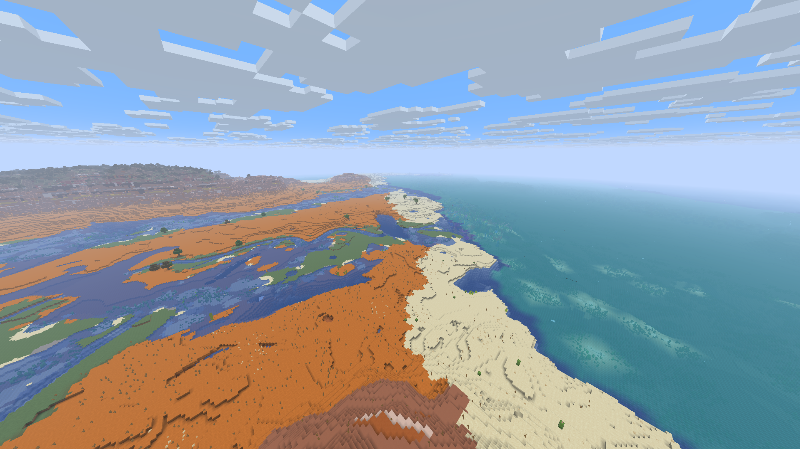

# Distant Horizons for Horizon Client — dormyu adaptation

Native Rust level-of-detail terrain for **Horizon f42ef42 / Minecraft 26.3**.
This repository maintains dormyu's adaptation of Deniz Şahin's Rust port of
Distant Horizons. Version **0.1.0+dormyu.18** corrects underwater skylight and
keeps aquatic plants visible where native chunks hand over to the nearest DH
detail level. The reproduced pale diagonal strip is absent in the reviewed
native 16 → 8 → 16 / DH 64 scene, its full-process reopen and the additional
native 32 → 16 → 32 / DH 128 sequence.

The checked native set includes unchanged Immersive Landscapes 0.6.0 and official
Zoom 2. [Validation and limits](docs/validation-dormyu.18.md) distinguish the
completed checks from the remaining work. Two Rust clients passed the functional
check. Installation and Prism read-back are recorded separately from these
native runtime checks.
Performance tests were omitted at the owner's request.



## What changed

Water depth now attenuates skylight in sampled water and the adjoining floor.
Raw kelp and seagrass states survive capture instead of becoming plantless water.
At width 1 in the existing Medium-or-higher handoff ring, plants use native model
geometry, texture coordinates, ambient occlusion and lighting, with the same
resident-chunk mask as the surrounding far terrain.

This update rebuilds derived DH/generated-column caches on first use. Saved
Minecraft chunks, player edits and IL recipes stay unchanged; a new world is not
required. Cache rebuilding and further exploration still require preparation.

## What is distributed

Releases contain source bundles (`.hnmod` and its source-distribution ZIP), not a
prebuilt Minecraft executable, dynamically loaded DLL or Java mod. The native
bundle must be compiled into the matching Horizon client. A source download alone
does not install the mod. Game resources, accounts and user worlds are excluded;
prepare game resources privately using your own Minecraft account.

## Build the pinned native set

Use [compatibility.json](compatibility.json) and Horizon commit
`f42ef42ef6ceccb3c6a20bea2481d87949a51c81`. The native hooks are pinned; another Nightly needs a
separate port and validation. Use an explicit `HORIZON_MIXINS_BIN` pointing to the
patched horizon-mixins tool, rather than assuming an upstream automatic installer
will build this adaptation.

For **Immersive Landscapes integration**, follow the full
[native build instructions](https://github.com/dormyu/immersive-landscapes/blob/main/docs/native-build.md): horizon-mixins `ddd9700` needs both the
inert `recursion_limit` handling and concrete `Self` resolution in cancellable
constructor HEAD return types. The older compatibility patch bundled in this DH
repository covers the former only; it is not a substitute for IL's complete
patched tool. The combined IL wrapper selects the tool via `HORIZON_MIXINS_BIN`.
All native mods must be staged together before compiling the client.

For standalone DH source work, the commands are provided by `tools/horizon.py`:

```sh
cargo test --lib --tests
cargo clippy --all-targets -- -D warnings
python tools/horizon.py build --horizon /path/to/pinned-horizon-source
python tools/horizon.py package
```

Set `HORIZON_MIXINS_BIN` first and use privately prepared matching resources to
launch the resulting executable. The Windows 16 GiB laboratory uses one Cargo job
and E: for all sources, caches and outputs; its measured build profile is recorded
in validation. The [previous README](UPSTREAM_README.md) is preserved verbatim as
historical documentation, including upstream instructions for older engine pins.

## Use and limits

Options → Mods → Distant Horizons controls LOD distance, quality and generation.
`/dh status`, `/dh on`, `/dh off` and `/dh save` expose renderer state. Keep Horizon's
independent native LOD renderer disabled when DH owns the distant view.
The owner's native 32 / DH 128 preferences remain the delivery target.

The reviewed scenes use DH 64/128 Medium, native 16 → 8 → 16 and 32 → 16 → 32,
smooth lighting and no shader pack in the Overworld. A distant blue/turquoise
boundary remains visible: surface biome data confirms the different water colors
of deep lukewarm ocean and warm ocean. Its current blending is narrow; it is
separate from the former bare underwater strip. More distant LOD levels still
simplify seabed and vegetation detail. Other lighting/shader modes and all scenes or seeds are not
certified. There are no new performance measurements or owner aesthetic approval.
See the [before/after gallery and remaining checks](docs/validation-dormyu.18.md).

## Credits and licenses

- **Original Distant Horizons:** James Seibel and contributors,
  [Distant Horizons project](https://gitlab.com/distant-horizons-team/distant-horizons).
- **Rust port and original Horizon bridge:** Deniz Şahin and contributors,
  [upstream repository](https://github.com/denizsahin7744/distant-horizons-for-horizon-client).
  Its original notices and AI-assistance credit remain in the archived README.
- **This adaptation:** dormyu — RustCore integration, renderer corrections and
  bounded validation. [ADAPTATION.md](ADAPTATION.md) preserves the change history.
- **Horizon:** Ludovic Marie and Horizon contributors; the adapted predictive
  tree-choice observer retains [Horizon's MIT notice](third-party/horizon-LICENSE).
- **horizon-mixins / native tooling:** original authors and contributors;
  [tooling MIT notice](third-party/horizon-mixins-LICENSE).

The DH adaptation remains **LGPL-3.0-only**: [LICENSE](LICENSE) and
[COPYING.GPL](COPYING.GPL). MIT notices apply to the identified Horizon/tooling
parts. Immersive Landscapes is a separate MIT-licensed generation mod. This fork
is not an official release or endorsement by the original DH or Horizon teams.
