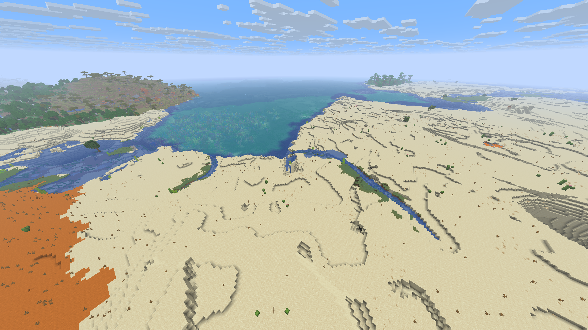

# Distant Horizons for Horizon Client — dormyu adaptation

Native Rust level-of-detail terrain for **Horizon f42ef42 / Minecraft 26.3**.
This repository maintains dormyu's adaptation of Deniz Şahin's Rust
port of Distant Horizons. Version **0.1.0+dormyu.17** adds supported narrow far-tree stems,
water-tint edge blending and bounded planner/tint optimizations.

The checked native set combines this renderer with Immersive Landscapes 0.6.0 and
official Zoom 2. Read [current validation](docs/validation-dormyu.17.md) for exact
source and runtime hashes, test hardware, functional checks, reviewed scenes and
remaining LOD limits. Performance tests were omitted at the owner's request.



## What is distributed

Releases contain source bundles (`.hnmod` and its source-distribution ZIP), not a
prebuilt Minecraft executable, dynamically loaded DLL or Java mod. The native
bundle must be compiled into the matching Horizon client. A source download alone
does not install the mod. Game resources, accounts and user worlds are excluded;
prepare game resources privately using your own Minecraft account.

## Build the pinned native set

Use [compatibility.json](compatibility.json) and Horizon commit
`f42ef42ef6ceccb3c6a20bea2481d87949a51c81`. The native hooks are pinned; another Nightly needs a
separate port and validation. Use an explicit `HORIZON_MIXINS_BIN` pointing to the
patched horizon-mixins tool, rather than assuming an upstream automatic installer
will build this adaptation.

For **Immersive Landscapes integration**, follow the full
[native build instructions](https://github.com/dormyu/immersive-landscapes/blob/main/docs/native-build.md): horizon-mixins `ddd9700` needs both the
inert `recursion_limit` handling and concrete `Self` resolution in cancellable
constructor HEAD return types. The older compatibility patch bundled in this DH
repository covers the former only; it is not a substitute for IL's complete
patched tool. The combined IL wrapper selects the tool via `HORIZON_MIXINS_BIN`.
All native mods must be staged together before compiling the client.

For standalone DH source work, the commands are provided by `tools/horizon.py`:

```sh
cargo test --lib --tests
cargo clippy --all-targets -- -D warnings
python tools/horizon.py build --horizon /path/to/pinned-horizon-source
python tools/horizon.py package
```

Set `HORIZON_MIXINS_BIN` first and use privately prepared matching resources to
launch the resulting executable. The Windows 16 GiB laboratory uses one Cargo job
and E: for all sources, caches and outputs; its measured build profile is recorded
in validation. The [previous README](UPSTREAM_README.md) is preserved verbatim as
historical documentation, including upstream instructions for older engine pins.

## Use and limits

Options → Mods → Distant Horizons controls LOD distance, quality and generation.
`/dh status`, `/dh on`, `/dh off` and `/dh save` expose renderer state. Keep Horizon's
independent native LOD renderer disabled when DH owns the distant view. The tested
visual profile uses native 16 → 8 → 16, DH 64 Medium, 1920 × 1080 and a 30 FPS cap.
The owner's installed native 32 / DH 128 preferences remain unchanged. The cap is
a test setting; this release provides no new FPS measurements or 120 FPS guarantee.

The DHH2 cache version rebuilds derived DH data on first use after this update.
Existing Minecraft chunks, player edits and saved IL recipes are unchanged; this
renderer update does not require a new world. Preparing the new cache takes time.
The validation report records remaining terrain, vegetation, lighting and water
transitions in the reviewed scenes. Owner aesthetic approval remains separate.

See the [reviewed delta scenes and native-distance transitions](docs/validation-dormyu.17.md#manual-visual-review-and-remaining-limits)
in the validation gallery.

## Credits and licenses

- **Original Distant Horizons:** James Seibel and contributors,
  [Distant Horizons project](https://gitlab.com/distant-horizons-team/distant-horizons).
- **Rust port and original Horizon bridge:** Deniz Şahin and contributors,
  [upstream repository](https://github.com/denizsahin7744/distant-horizons-for-horizon-client).
  Its original notices and AI-assistance credit remain in the archived README.
- **This adaptation:** dormyu — RustCore integration, renderer corrections and
  bounded validation. [ADAPTATION.md](ADAPTATION.md) preserves the change history.
- **Horizon:** Ludovic Marie and Horizon contributors; the adapted predictive
  tree-choice observer retains [Horizon's MIT notice](third-party/horizon-LICENSE).
- **horizon-mixins / native tooling:** original authors and contributors;
  [tooling MIT notice](third-party/horizon-mixins-LICENSE).

The DH adaptation remains **LGPL-3.0-only**: [LICENSE](LICENSE) and
[COPYING.GPL](COPYING.GPL). MIT notices apply to the identified Horizon/tooling
parts. Immersive Landscapes is a separate MIT-licensed generation mod. This fork
is not an official release or endorsement by the original DH or Horizon teams.
