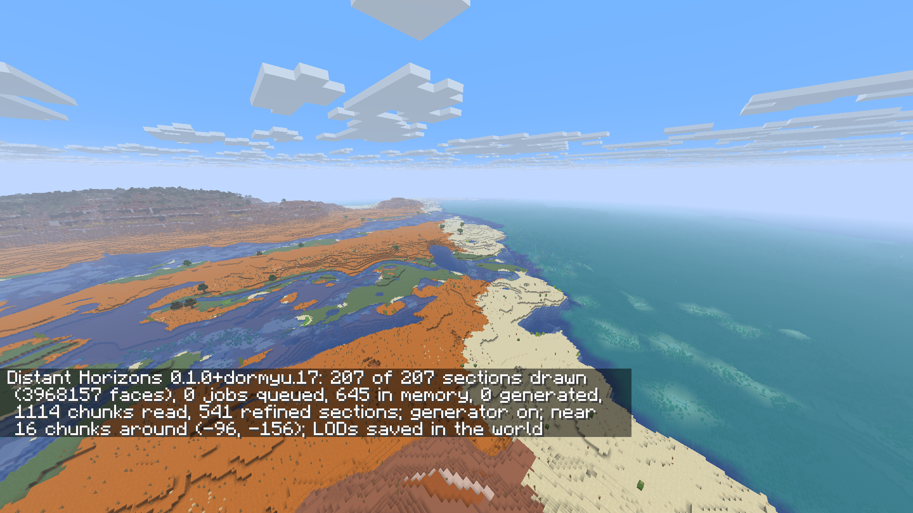
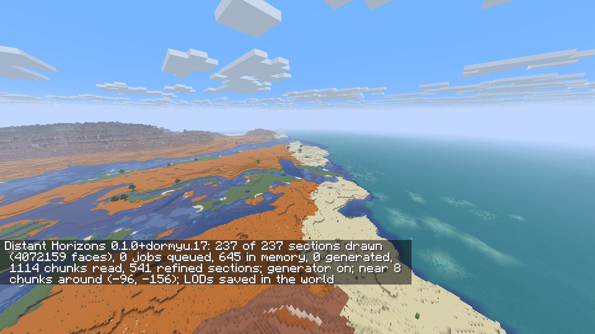
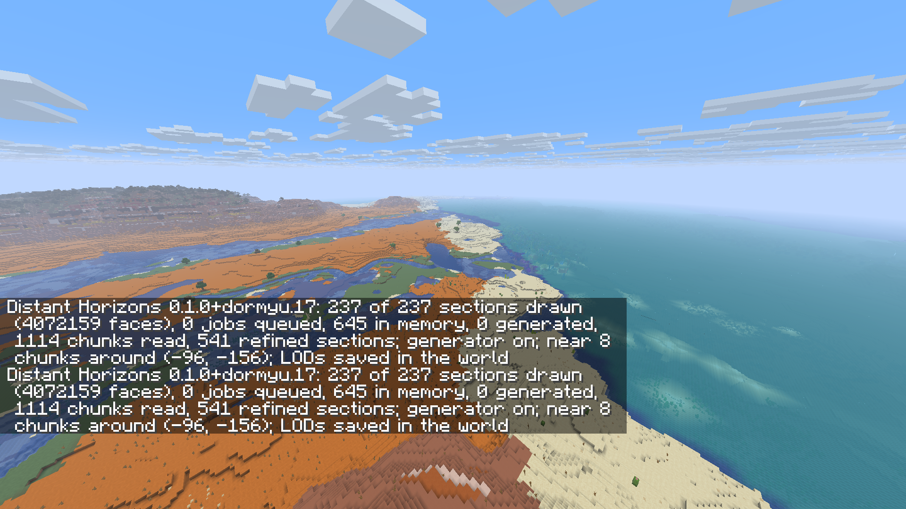
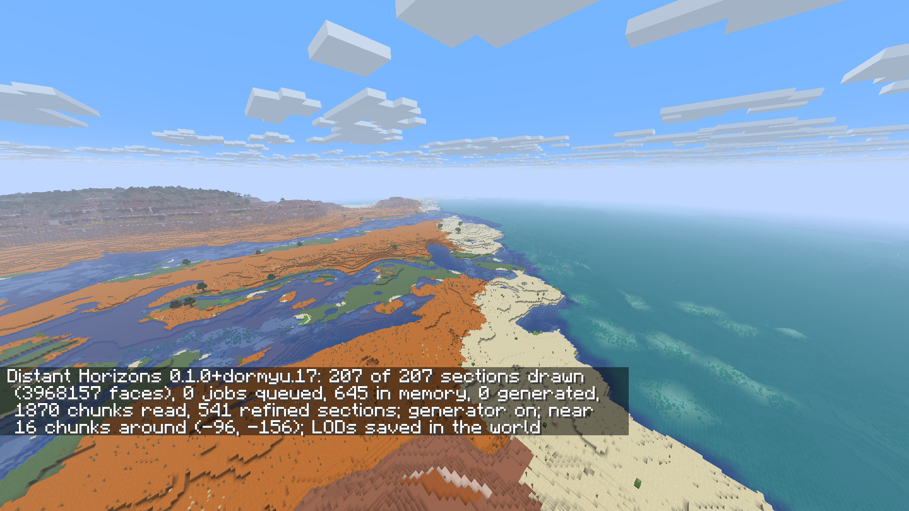
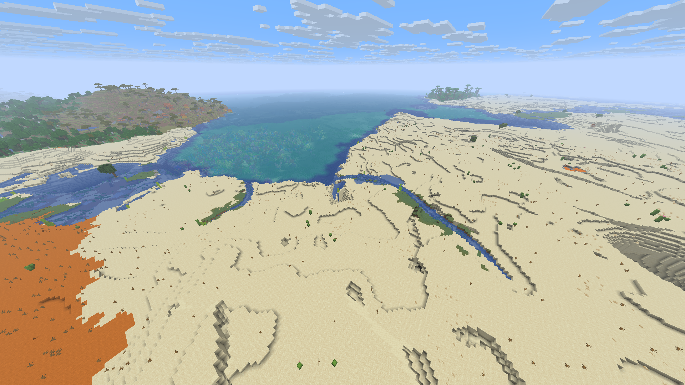

# DH dormyu.17 — selected native renderer validation

<!-- DH17-SELECTED-RENDERER-QA -->

This report is generated only after `install_renderer.validate_build()` and
`install_renderer.evidence_gates()` accept the immutable delivery selection.
It covers this exact source and the selected functional tests and visual scenes.
Installation, Prism and release-download verification are recorded separately.

## Identity and conditions

- Horizon: `f42ef42ef6ceccb3c6a20bea2481d87949a51c81`; Minecraft 26.3.
- DH source: `47888d3dec2edda918c367a5a60d3afc8f9f2fd0`; version `0.1.0+dormyu.17`.
- Runtime SHA256: `a6a3fcfad445c5af67bf9a5e439d3512621e1cae296734b80e090c6f7ade6b07`.
- IL source: `72ede8a6b2ff6505dd1af74ac6c42199f19f46e0`; version 0.6.0.
- Zoom source: `725ff7a41017c40104273e407264e0ebee87e567`; version 2.0.0.
- Native build receipt SHA256: `9a977662a605974f377e42d7fcc9900717f6d6e2f5887fda3846b50f6dc76a4c`.
- Delivery selection SHA256: `d773c92a93ccd7fdccc487637d970410d712da34f7a65c2b53283cda602e729c`.
- Local QA root: `far-canopy-optimized-2026-11-10`. Only the selected reports below supply current measurements.

The combined client retains byte-identical IL/Zoom Rust, descriptor 11 and
vanilla-natural-v7. The final source freeze records one Cargo job, modded crate
optimization level 2 and incremental compilation disabled. Documentation may
follow the frozen source commit; that does not identify a different gameplay build.

The selected visual run uses an isolated QA world and cache from this runtime at native 16 → 8 → 16,
DH 64 Medium, 1920 × 1080 and a 30 FPS cap. The original canopy camera is checked separately
after the selected DH view finishes and the status notification fades. The cap
is a test setting. Installed native 32 / DH 128 preferences are preserved;
they differ from the visual profile used here.

## Observed hardware

| Hardware | Observed value |
| --- | --- |
| CPU | Intel(R) Core(TM) i5-9400F CPU @ 2.90GHz (6 cores / 6 threads) |
| GPU | NVIDIA GeForce RTX 2060; driver 32.0.16.1088 |
| RAM | 16 GiB installed; 15.937 GiB visible to Windows |
| Hardware receipt SHA256 | 3378ca00ddf2fa4d5b62cf716fb3d460462957fa16beadbddaaaefa9cae041e4 |

The hardware receipt identifies this QA host; it is not performance evidence.

## Performance tests explicitly waived by the owner

FPS/performance tests were omitted at the owner's request. The selected private
waiver binds that request to the exact runtime/build with owner_requested=true
and performance_tested=false.

This delivery reports no new average FPS, 1% low, frame-time or cold/warm timings,
and makes no 120 FPS guarantee. Interrupted or failed attempts retain their original
status. Functional and visual checks still have to pass independently.

The DHH2 derived-cache/fingerprint change forces older DH cache data to be
reprepared on first use. Saved Minecraft chunks, edits and IL recipes are not
migrated. First-use cache rebuilding still requires work, but its duration and
peak memory are not validated for this delivery. Exploring additional areas requires
further preparation.

## Native behavior and two-client scope

Selected solo checks passed named world creation, block save/full process
restart, disabled-generator vanilla behavior and unchanged legacy recipe copies.
The selected two-client report's scope is: **two Rust clients, loopback, near2; functional smoke, not performance acceptance**.

| Rust client | Native render distance | Chunks at final readback | Decode errors | Exit code |
| --- | --- | --- | --- | --- |
| one | 2 | 49 | 0 | 0 |
| two | 2 | 49 | 0 | 0 |

Both Rust clients observed the same emerald-block edit; selected transport/decode
error counts are zero. DH toggling released resident quads and recreated visible
geometry; Zoom input remained independent. Server exit code:
`0`. The loopback run checks functionality; native 32
multiplayer performance and complete remote decoration are outside its scope.
The separate delta check exercises native 16 → 8 → 16 / DH 64 with immediate/settled
images and unchanged native block samples, on this same frozen runtime. The
additional canopy scene uses position [-1799.5, 123, -1176.5], yaw 53.1301 and
pitch 35.8. Its prepared DH view and clean scene are reviewed separately.

## Bounded water fixture

The three saved mixed-detail boundaries check 195 edge vertices.

| Saved boundary | Before maximum channel delta | After maximum channel delta | Full/perimeter samples |
| --- | --- | --- | --- |
| 0 | 10.00 | 0.50 | 4356/512 |
| 1 | 5.00 | 0.50 | 4356/512 |
| 2 | 10.00 | 0.50 | 4356/512 |

The optimized coarse perimeter path produces identical complete fine-grid
vertices and emitted rectangles to the former full-coarse-field path in all three
cases. Interiors remain unchanged; the remaining ≤0.5 channel-unit discrepancy is
8-bit interpolation rounding. This is a data/helper fixture, not gameplay proof
or an explanation for every underwater patch.

## Manual visual review and remaining limits

Review scope: Manual review of all twelve actual PNGs from the isolated same-candidate visual-02 world/cache: delta native16 to8 to16 and the original canopy camera, DH64 Medium,1920x1080,cap30. This is targeted renderer QA, not FPS or owner aesthetic acceptance.

All ten delta scene/status PNGs and both canopy PNGs were inspected. The repaired shore and braided water channels remain connected; no exposed void, tall water wall or persistent missing-terrain band appears at the checked bank. Returning to native16 restores the visible shoreline geometry. The before/after native block checks also preserve the dry bank and adjacent water.

The clean canopy image shows connected vertical stems under the formerly floating far-right crown group. The surrounding far terrain is populated, and the status capture confirms216/216 selected sections with zero jobs queued. The historical DH16 reference uses a different native/far profile, so this is not a pixel-matched full-frame A/B performance or quality comparison.

Water top colours remain continuous across the checked terrain handoff without a missing surface. Native8 replaces fine aquatic vegetation and seabed detail with coarse pale patches, including a visible diagonal detail/lighting transition on the right. This residual is not claimed fixed by water-top tint interpolation. The bounded water fixture separately verifies stitched colour vertices; screenshots alone do not establish the cause of every underwater patch.

Chat/status overlays in the delta and canopy-status images are intentional and obscure part of the lower/left frame. Red chat lines state already-set world rules, not a crash. The clean canopy scene was captured after notification fade. The earlier visual01 camera left the bank outside the circular native loading radius; its failed report is preserved. Visual02 uses a verified copy of that isolated same-runtime world/cache and the corrected camera, not a new cold benchmark.

- Underwater LOD still differs visibly in seabed detail, aquatic vegetation and lighting; the pale diagonal patch is a remaining renderer limitation, not a resolved water-tint defect.
- Coarse distant vegetation, terrain steps and native biome material/colour boundaries remain visible. This check covers the selected cameras and does not certify every seed, distance or scene.
- First-use DH cache rebuilding and newly explored terrain require preparation. Performance tests were explicitly omitted; no new FPS, frame-time,32/128 performance or heavy-pack guarantee is made.
- The owner has not given aesthetic approval of this exact delivered candidate.

These observations come verbatim from the selected manual visual receipt.
`owner_acceptance` remains false. Only the exact reviewed PNGs below are copied;
no crops, edits, annotations or generated substitutes were applied.

| Capture | PNG | SHA256 |
| --- | --- | --- |
| Delta camera at native 16 / DH 64 before changing native render distance | [delta-near16-before.png](images/dormyu.17/delta-near16-before.png) | 6b3cc25e922414866c369c6c3da5c6ab01f139ec5e74ebd4511e1d7dafd71d78 |
| Delta camera immediately after changing native distance to 8 | [delta-near8-immediate.png](images/dormyu.17/delta-near8-immediate.png) | 3e156fb119bdf3b69d043f963dcf1d74b048166086a47352f43897b29dfaa3d0 |
| Delta camera after native distance 8 and DH 64 settled | [delta-near8-settled.png](images/dormyu.17/delta-near8-settled.png) | e65221153ff013823916eec8f9aa89987cbe3515fa6bf7acd5904557f36e8aa8 |
| Delta camera immediately after restoring native distance 16 | [delta-near16-immediate.png](images/dormyu.17/delta-near16-immediate.png) | ec351e541f1e92f966cd9b1ab4f6a230d561551d59a6a0d741630bb50b575619 |
| Delta camera after native distance 16 and DH 64 settled | [delta-near16-settled.png](images/dormyu.17/delta-near16-settled.png) | 104f9f314828e247002539a6e65b5c943bf80309e93367b10ce45dec9ce16e44 |
| Original canopy camera at native 16 / DH 64, after DH preparation and notification fade | [delta-canopy.png](images/dormyu.17/delta-canopy.png) | 8bb7a8911ab92d5dd5eabdf2712699efe707790efdf62040638fe7adadd5d70f |

### Delta camera at native 16 / DH 64 before changing native render distance

### Delta camera immediately after changing native distance to 8

### Delta camera after native distance 8 and DH 64 settled

### Delta camera immediately after restoring native distance 16

### Delta camera after native distance 16 and DH 64 settled

### Original canopy camera at native 16 / DH 64, after DH preparation and notification fade

## Selected receipt provenance

| Selected evidence | Report within QA | SHA256 |
| --- | --- | --- |
| solo | reports/native-functional-solo.json | 918426752679a5bdec236a75b880b6ff45147c90276e16a9476ecac6ca075994 |
| network | reports/native-functional-network.json | 2b547fb9a4b8a44ce6b4b0abf48f86db550233b24d207af7d46172f81a6e58b1 |
| delta | reports/delta-handoff-visual-02.json | 2284c65c827f918038eb58f96f0858c33bc965340a86f65b8f2eefac9e2431e1 |
| visual | reports/visual-review.json | 5b9c3f2a503879dce7ad0de04cc1a717bed62a5d93e4bf3f3d3a3532fc755b5c |
| water_fixture | water-tint-native-fixture-02.json | bd9bede7fe1dad9498a34129d8a19a1374ce9f9040e5be86b1d5b5036b540364 |
| performance_waiver | reports/performance-waiver.json | 6126fd362a8aef6d57da2a4483091ee22eae4f17474c9d2b6b9de88ddf215e81 |

The complete local gate also binds the native collector probe, build inputs,
driver hashes, functional reports and image hashes. Historical DH 16 and intermediate
DH 17 reports retain their original scope and are excluded from these results.
