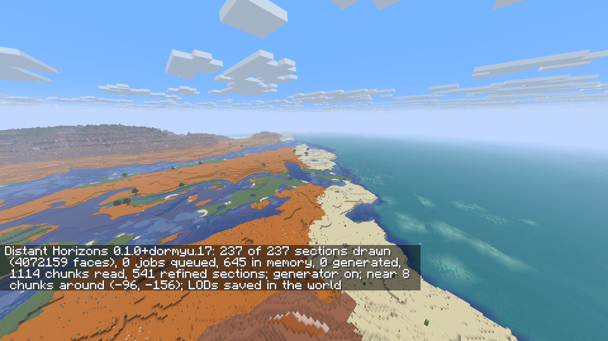
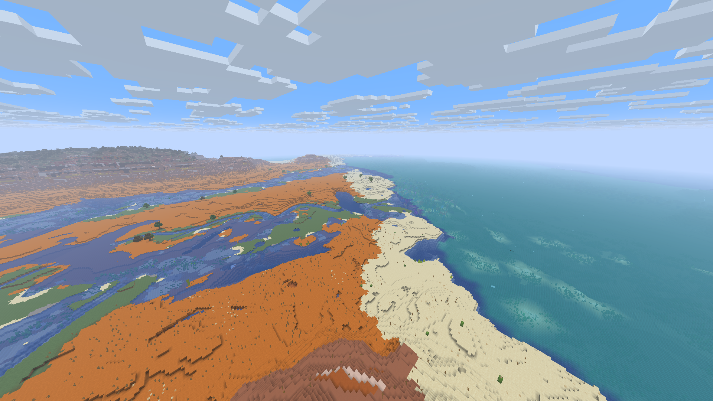
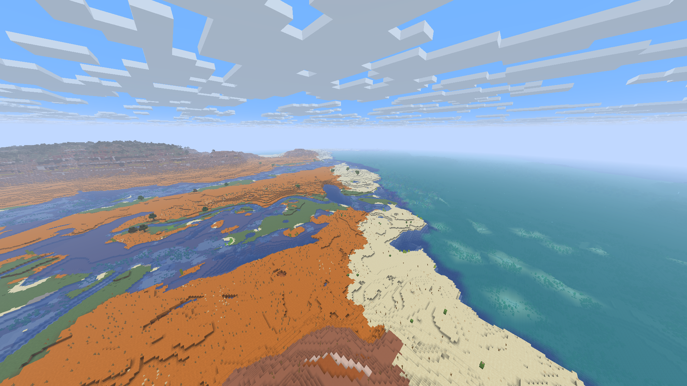
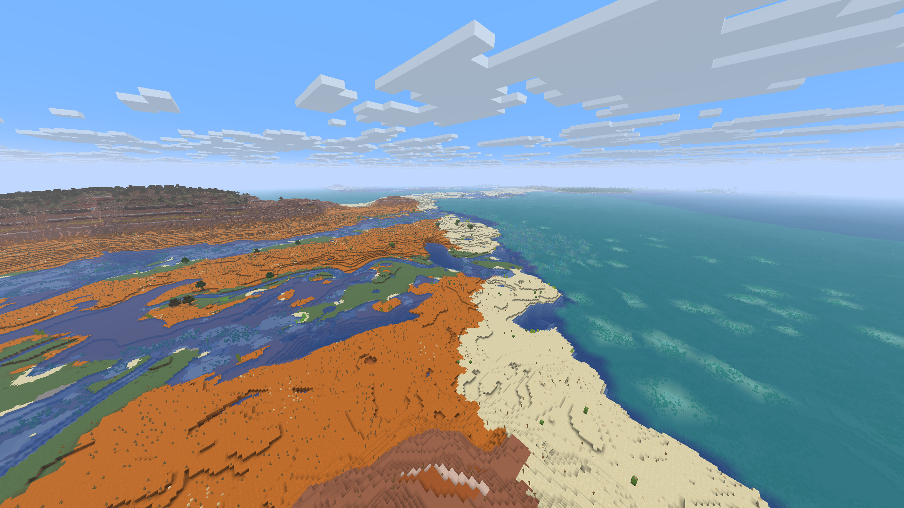

# DH dormyu.18 — underwater handoff validation

The reproduced pale diagonal strip is absent in the reviewed native 16 → 8 → 16
/ DH 64 scene, its full-process reopen and an additional native 32 → 16 → 32
/ DH 128 sequence. Two Rust clients also passed the functional check.
This document records native runtime checks. Installation and actual Prism
read-back have their own delivery records; they are not inferred from these checks.

## Build and scope

- Horizon `f42ef42ef6ceccb3c6a20bea2481d87949a51c81`, Minecraft 26.3.
- DH `0.1.0+dormyu.18`, compiled source `3a8aa870971a3213f8436fe8e299eb95d30b4c73`.
- Runtime SHA256: `33992c7848f91b2a3a730c5e0d267edf57e188d2461ed152aa73129b651a2047`.
- Immersive Landscapes 0.6.0 and Zoom 2.0.0 Rust are unchanged. IL retains
  descriptor 11 / vanilla-natural-v7; saved worlds keep their own recipes.
- Final build: `client-02`, one Cargo job, modded crate optimization level 2,
  incremental compilation disabled.
- Local evidence: `underwater-seam-aquatic-2026-11-11`. Earlier candidate and
  historical DH17 reports retain their original results.

Visual checks use an isolated, verified copy of a DH17 QA world. The primary
run is `visual-fixed-01`; the same saved QA world is reopened in a fresh process
as `visual-fixed-01-reopen`. The profile is native 16 → 8 → 16 / DH 64 Medium,
1920 × 1080, simulation distance 5, smooth lighting, no shader pack and native
Horizon LOD disabled. The 30-frame cap is a capture setting, not a measurement.
Owner preferences remain native 32 / DH 128.

The separate `visual-owner32` run copies the same-candidate fixed-01 QA world;
it does not replace the direct DH17-source primary/reopen provenance. All five
of its native 32 → 16 → 32 / DH 128 images were inspected. An independent copy
then compared normal DH128, debug detail colors, normal DH64 and DH off.

## Change and evidence

Sampled water and its adjoining floor now attenuate skylight with depth instead
of retaining surface brightness. Block light and closed-roof/ice behavior are
preserved in the native fixture. Raw kelp, kelp-plant, seagrass and tall-seagrass
states retain their properties through generated/saved/native-summary capture.
At width 1 in the existing Medium-or-higher handoff ring, aquatic plants use the
native model geometry, offsets, texture layers, UV, ambient occlusion and light.
The resident-chunk cutout is shared with terrain; water remains continuous.

| Check | Current result |
| --- | --- |
| Standalone logic tests and Clippy | PASS before the native build; 70 tests |
| Full client and frozen source | PASS, `client-02` |
| Native capture hooks | PASS, `native-hook-runs/hooks01` |
| Four actual aquatic models | PASS, `native-aquatic-03`; matching geometry/UV/layers, zero tested vertex RGB/light delta, resident cutout |
| Actual native water lighting/meshing | PASS, `native-light-04`; depth, roof, ice, seagrass, block-light and geometry cases |
| Native 16 → 8 → 16 / DH 64 | PASS, five immediate/settled PNGs inspected |
| Save and full-process reopen | PASS; reopened scene inspected |
| Native 32 → 16 → 32 / DH 128 | PASS, all five separate `visual-owner32` images inspected; distant biome-tint limit below |
| Two Rust clients / loopback | PASS; both players and shared block visible, DH off/on and independent Zoom, no far-transport errors, client/server exit0 |

The hooks and both native fixtures are bound to the exact final client's library
and dependency fingerprint. Earlier fixtures linked against another library are
not substituted for these results. Native model comparison covers vanilla
Overworld smooth lighting without shaders; it does not validate other modes.

## Manual visual review

All five primary captures were inspected: settled native16, immediate and settled
native8, then immediate and settled return16. The previously bare, pale diagonal
strip on the right no longer appears at the native8 boundary. Aquatic vegetation
remains visible there, and no continuous replacement strip is apparent farther
out in the visible water. The return to native16 does not reproduce the former
bare-to-vegetated switch. The reopened view was reviewed separately and passed.

The additional 32 → 16 → 32 / DH 128 sequence also preserves the aquatic detail
across the former bare strip. A separate distant blue/turquoise line remains.
Four projected pixel pairs straddle deep_lukewarm_ocean water (`#45adf2`) and
warm_ocean water (`#43d5ee`) in existing DH surface data, with the same water
state and surface height. Three pairs stay inside the same detail-level tile;
the visible line is above the red width1 band in the debug view, not its edge.
This identifies a biome-water-tint boundary with narrow current interpolation,
not a recurrence of the lost-vegetation strip. DH64 fog masks it more strongly;
that is not a fix. DH off removes/fogs the distant area and cannot establish how
native water would blend at those same coordinates.

Small differences in water-surface raster detail and coarse terrain remain;
the images are not pixel-identical. These observations apply to the checked
camera and sequence, not every underwater scene, seed or distance.

### Historical reference — DH dormyu.17

This is the preserved DH17 native8 / DH64 reference, not a capture of the current
runtime. Historical test results and their scope are unchanged.

### DH dormyu.18 — native8 after preparation

### DH dormyu.18 — native16 after full-process reopen

### DH dormyu.18 — native32 / DH128

The original bare strip is absent. The separate distant blue/turquoise biome
colour boundary discussed above is still visible in this unedited capture.

## Saved worlds and remaining limits

Derived DH/generated-column caches and native summary revisions are rebuilt so
old plantless data cannot bypass the updated capture. Minecraft chunk NBT,
player edits and saved IL recipes are unchanged; this update needs no new world.
Initial rebuilding and newly explored terrain still require preparation.

The distant biome-water-color boundary remains visible. More distant LOD levels
retain simplified seabed and vegetation. The result does
not certify all terrain/biome boundaries, alternative lighting/shader modes or a
complete heavy modpack. Owner aesthetic approval remains absent.

Performance tests were explicitly waived by the owner (`performance_tested=false`).
No frame-rate, frame-time, preparation-time or memory result is claimed for this
candidate. Functional and visual checks remain separate requirements.

Original DH/Rust-port attribution and the bundled LGPL/GPL and Horizon/tooling
MIT notices remain intact; see [credits](../README.md#credits-and-licenses).
